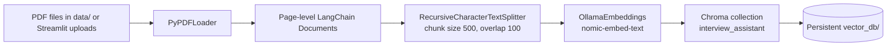
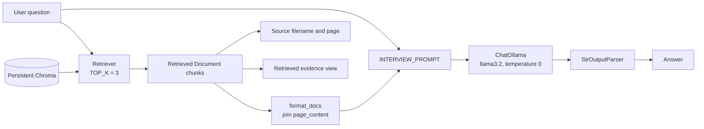

# AI Interview Preparation Assistant

A local, document-grounded interview preparation assistant built with Python, LangChain, Ollama, Chroma, and Streamlit. It indexes PDF study material, retrieves the most relevant passages for a question, and asks a local language model to answer from those passages. The interface exposes source pages and retrieved evidence so users can inspect the material behind an answer.

## Problem

Interview notes are often spread across long PDFs, making focused revision and source checking slow. This project turns those PDFs into a searchable knowledge base and provides concise answers tied to retrieved text. If the supplied context does not support an answer, the prompt instructs the model to return a fixed abstention response rather than use outside knowledge.

## Features

- Upload and index one or more PDFs through Streamlit, or index PDFs already in `data/` with `ingest.py`.
- Split page-level PDF documents into overlapping chunks and store them persistently in Chroma.
- Add uploaded chunks to an existing Chroma collection; the first upload creates it.
- Retrieve the configured top three chunks for each question.
- Generate interview-oriented answers with a local Ollama chat model and a context-only prompt.
- Display PDF filename and page metadata and inspect the exact retrieved text in the UI.
- Run a console question loop with `app.py` or use the browser UI with `streamlit_app.py`.
- Evaluate retrieval count, metadata, evidence concepts, answer concepts, and the exact abstention sentence using `evaluate.py` and `evaluation_cases.json`.

## Architecture

### Indexing



### Question answering



Indexing and querying are separate operations. Indexing embeds document chunks and persists them. At query time, the same embedding model embeds the question for similarity search; the stored PDF chunks are not re-embedded. Retrieval supplies candidate evidence, and the prompt tells the model to use only the supplied context.

## End-to-end execution

1. `load_documents(DATA_PATH)` recursively discovers `*.pdf` files and loads page-level documents with `PyPDFLoader`.
2. `split_documents(documents)` uses `RecursiveCharacterTextSplitter` with `CHUNK_SIZE=500` and `CHUNK_OVERLAP=100`. The source and page metadata accompany the chunks.
3. `create_vector_store(chunks)` embeds the chunks through `OllamaEmbeddings(model="nomic-embed-text")` and stores text, vectors, and metadata in the `interview_assistant` Chroma collection at `vector_db/`.
4. For a question, `get_retriever()` opens that collection and configures `k=TOP_K` (3). `retriever.invoke(question)` embeds the query and retrieves the closest chunks.
5. `format_docs(retrieved_docs)` joins the chunk text. The question and context are passed to the generation chain.
6. `INTERVIEW_PROMPT | ChatOllama(...) | StrOutputParser()` produces a plain-text answer. The prompt specifies an exact fallback: `The provided documents do not contain this information.`
7. The same retrieved documents provide source metadata and, in Streamlit, the evidence text. There is no second retrieval for citations.

## Components

| File/module | Responsibility |
|---|---|
| `streamlit_app.py` | PDF upload, index status, question input, answer/source/evidence display; coordinates shared backend functions. |
| `app.py` | Interactive command-line question loop; retrieves once, generates an answer, and prints source filename/page. |
| `ingest.py` | Offline indexing entry point for PDFs already in `data/`. |
| `evaluate.py` | Runs the JSON evaluation cases, with optional single-case and retrieval-only modes. |
| `evaluation_cases.json` | Positive Java concept cases and a Kubernetes abstention case. |
| `src/config.py` | Relative data/index paths, chunking values, top-k, and model names. |
| `src/document_loader.py` | Recursive PDF discovery and page-level loading. |
| `src/text_splitter.py` | Configured document chunking. |
| `src/vector_store.py` | Ollama embeddings and Chroma create/load/add operations. |
| `src/retriever.py` | Loads the persistent store and creates a top-k retriever. |
| `src/prompts.py` | Context-grounding, response-format, and abstention instructions. |
| `src/rag_chain.py` | Context formatting and LCEL generation chain. |
| `src/utils.py` | Legacy helper for sampling `.txt` files; not used by the PDF RAG flow. |
| `data/` | PDF source material. |
| `vector_db/` | Persistent Chroma data created by indexing. |

## Technologies

- **Python** for application and evaluation scripts.
- **LangChain** abstractions: `Document`, `PyPDFLoader`, `RecursiveCharacterTextSplitter`, `PromptTemplate`, retriever, and LCEL.
- **Ollama** for local inference: `nomic-embed-text` embeddings and `llama3.2` chat generation.
- **Chroma** (`langchain-chroma`) for persistent vector storage and similarity search.
- **Streamlit** for the upload, status, question-answering, and evidence interface.
- **PyPDF** via `PyPDFLoader` for PDF text extraction.

No API key is configured or used in the current implementation. Ollama must be running locally with both configured models available.

## Configuration

The current settings are constants in `src/config.py`; there is no `.env` configuration in the code.

```python
DATA_PATH = "data"
VECTOR_DB_PATH = "vector_db"

CHUNK_SIZE = 500
CHUNK_OVERLAP = 100
TOP_K = 3

EMBEDDING_MODEL = "nomic-embed-text"
LLM_MODEL = "llama3.2"
```

Paths are relative to the current working directory. Run commands from the repository root. Keep the embedding model consistent between indexing and querying so vectors remain in the same embedding space.

## Setup

Prerequisites: Python 3.10 or newer, [Ollama](https://ollama.com/) installed and running, and sufficient local resources for the selected models.

Create and activate a virtual environment, then install the packages imported by the current source:

```powershell
python -m venv .venv
.\.venv\Scripts\Activate.ps1
python -m pip install langchain langchain-community langchain-text-splitters langchain-ollama langchain-chroma chromadb pypdf streamlit
```

Download the configured Ollama models:

```powershell
ollama pull nomic-embed-text
ollama pull llama3.2
```

The checked-in `requirements.txt` is inherited from an earlier scaffold and does not currently declare all dependencies imported by the application (including Streamlit and the LangChain integrations above). The installation command above reflects the imports in this repository. Aligning the requirements file with those imports is a useful repository maintenance task.

## Run

### Streamlit interface

```powershell
python -m streamlit run streamlit_app.py
```

Choose one or more PDFs and click **Upload & Index**. The files are saved in `data/` and their chunks are added to the persistent collection. Enter a question and click **Get Answer** to view the answer, source pages, and retrieved evidence.

### Command-line interface

Put PDFs under `data/`, create the index, then start the console assistant:

```powershell
python ingest.py
python app.py
```

Type a question at the prompt; enter `exit` to quit. Both commands take no arguments. The CLI expects an index to exist before questions can be answered.

### Evaluation

The evaluation script expects an existing vector index and Ollama access. It checks retrieval count and metadata, concept presence in retrieved evidence and generated answers, and exact abstention for the negative case. These are lightweight deterministic string checks, not a comprehensive quality benchmark.

```powershell
python evaluate.py
python evaluate.py --retrieval-only
python evaluate.py --case functional_interface
python evaluate.py --cases path\to\cases.json
```

`--retrieval-only` skips generation; `--case` selects a case ID; `--cases` selects a JSON case file. The script exits with code 1 if any selected check fails.

## Example interaction

With Java interview PDFs indexed, a supported question such as:

```text
What is a functional interface?
```

is answered from the retrieved passages, with the source PDF and page shown by the app. For a question not supported by retrieved context, the prompt requires:

```text
The provided documents do not contain this information.
```

Actual answer wording and retrieved pages depend on the indexed PDFs and the local model. Similarity search still returns the closest chunks for an unrelated query; the prompt relies on the model to abstain based on their contents.

## Design choices and trade-offs

- **Local models:** embeddings and generation run through Ollama, avoiding a hosted-model API in this implementation; local runtime and model downloads are prerequisites.
- **Separated indexing and querying:** `ingest.py` prepares the knowledge base, while the CLI and Streamlit app query it.
- **Small overlapping chunks:** the 500-character size and 100-character overlap are fixed defaults intended to preserve nearby context; they have not been exposed as user settings.
- **Persistent Chroma:** the store can be reused across runs. Streamlit adds uploaded chunks to the existing collection rather than rebuilding it.
- **Single retrieval for answer and attribution:** the retrieved documents feed both generation context and source/evidence display.
- **Prompt-based grounding:** instructions request abstention, but this is not a formal guarantee that the model will always follow them.

## Limitations and possible next steps

- There is no similarity-score threshold; top-k returns the closest available chunks even when they are weak matches.
- Re-uploading a PDF can add duplicate chunks. There is no document deletion, deduplication, or update/version mechanism.
- PDFs with scanned images or poor text extraction may yield little usable content; OCR is not implemented.
- Evaluation uses four fixed cases and simple expected-term checks; it does not measure retrieval ranking quality, factual correctness comprehensively, latency, or cost.
- `tests/test_smoke.py` imports a FastAPI `app` and `/ping` endpoint, but the current `app.py` is a console program and defines neither. The smoke test and `requirements.txt` therefore appear to belong to an earlier scaffold and need alignment before they can serve as current project checks.
- The prompt requests a structured answer when evidence is present, but does not validate that every heading is returned.

## Project structure

```text
07-Interview-Assistant/
├── app.py
├── streamlit_app.py
├── ingest.py
├── evaluate.py
├── evaluation_cases.json
├── requirements.txt
├── data/                         # Source PDFs
├── vector_db/                    # Persistent Chroma store
├── src/
│   ├── config.py
│   ├── document_loader.py
│   ├── text_splitter.py
│   ├── vector_store.py
│   ├── retriever.py
│   ├── prompts.py
│   ├── rag_chain.py
│   └── utils.py                  # Legacy text sample helper
└── tests/
    └── test_smoke.py             # Earlier FastAPI scaffold test
```

## LinkedIn-ready summary

**Built a local AI Interview Preparation Assistant using LangChain, Ollama, Chroma, and Streamlit.** The application ingests PDF study notes, splits and embeds their content into a persistent vector database, retrieves relevant passages for user questions, and generates context-grounded interview answers with a local LLM. It also surfaces source pages and retrieved evidence for transparency, supports incremental PDF uploads, and includes a small evaluation harness for retrieval metadata, expected concepts, and abstention behavior.

**Highlights:** Python · Retrieval-Augmented Generation (RAG) · LangChain/LCEL · Ollama · ChromaDB · Streamlit · PDF ingestion · Prompt grounding · Source attribution · Evaluation
